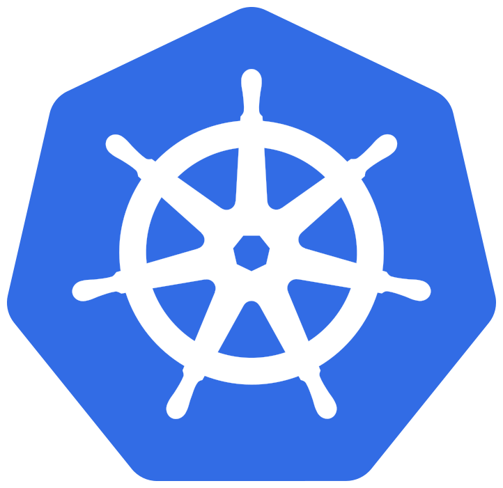
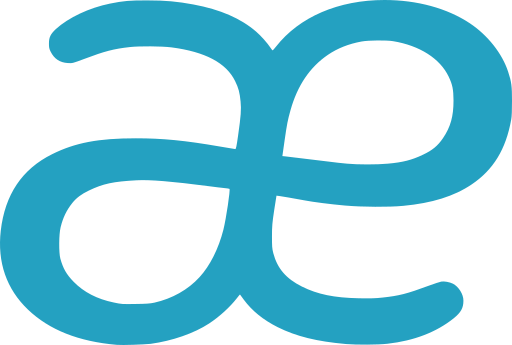
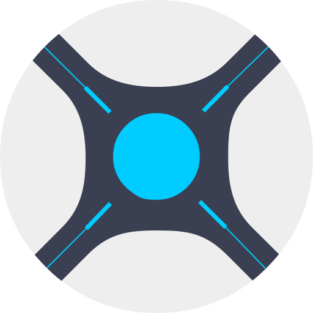

# Home Server

A k3s home server with Git-managed applications, shared media storage, single
sign-on, and VPN-routed services. Argo CD renders the local Helm charts and
reconciles the cluster; Infisical supplies secrets through External Secrets.

## Functionality

| | Service | Purpose and documentation |
| --- | --- | --- |
|  | k3s | Kubernetes on the home server. [Server setup](docs/server-setup.md) · [k3s docs](https://docs.k3s.io/) |
|  | Argo CD | GitOps deployment and self-healing. [Kubernetes setup](docs/kubernetes-setup.md) · [Operations](docs/argocd.md) |
|  | Traefik & cert-manager | HTTPS ingress, Let's Encrypt DNS-01 certificates, and Authentik forward auth. [Bootstrap](docs/kubernetes-setup.md) · [cert-manager docs](https://cert-manager.io/docs/) |
|  | Infisical & External Secrets | External secret storage and Kubernetes Secret synchronization. [Required secrets and ordering](docs/kubernetes-setup.md#secrets-and-creation-order) |
|  | Authentik | Argo CD SSO and authenticated media dashboards, configured through blueprints. [Authentik guide](docs/authentik.md) |
|  | Cloudflare | Dynamic DNS, tunnel connectivity, and DNS challenge credentials. [Prerequisites](docs/kubernetes-setup.md#prerequisites) · [Tunnel docs](https://developers.cloudflare.com/cloudflare-one/networks/connectors/cloudflare-tunnel/) |
|  | Seerr & Jellyfin | Media requests and playback. [Seerr docs](https://docs.seerr.dev/) · [Jellyfin docs](https://jellyfin.org/docs/) |
|   | Radarr & Sonarr | Movie and series library automation. [Radarr docs](https://wiki.servarr.com/radarr) · [Sonarr docs](https://wiki.servarr.com/sonarr) |
|  | Bazarr | Subtitle automation. [Bazarr docs](https://wiki.bazarr.media/) |
|   | Prowlarr & SABnzbd | Indexer management and Usenet downloads through the Podroute/Gluetun VPN gateway. [VPN guide](docs/podroute.md) · [Prowlarr docs](https://wiki.servarr.com/prowlarr) · [SABnzbd docs](https://sabnzbd.org/wiki/) |
|  | PostgreSQL & storage | Host PostgreSQL for Authentik, NFS media shares, and retained local application config volumes. [Server setup](docs/server-setup.md) |

The [bootstrap values](bootstrap/values.yaml) are the enabled-application list.

### Overview

## Setup

1. **[Prepare the server](docs/server-setup.md):** install k3s, NFS, and PostgreSQL.
2. **[Bootstrap Kubernetes](docs/kubernetes-setup.md):** prepare secrets, install
   controllers and Argo CD, then create the `home-server` root Application.
3. **Configure and operate applications:** [Authentik](docs/authentik.md),
   [Argo CD](docs/argocd.md), and [Podroute VPN](docs/podroute.md).

Host provisioning, database/media backups, and application data are not recreated
by GitOps. See the [reproducibility boundary](docs/kubernetes-setup.md#what-gitops-reproduces).
