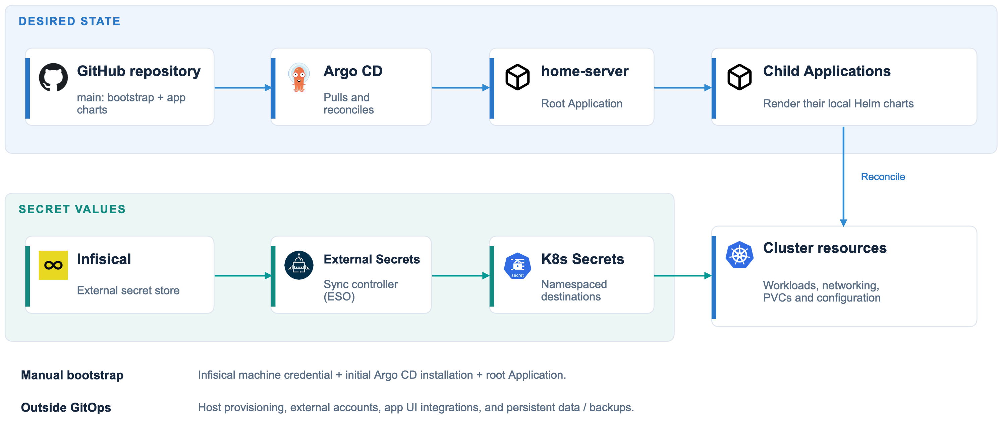

# Kubernetes Setup

Bootstrap a prepared k3s server into the Git-managed configuration. Run local
commands from the repository root with administrator cluster access. For an
already managed cluster, use [existing-cluster guidance](#existing-clusters)
instead of repeating first-install commands.

## What GitOps reproduces

The [bootstrap chart](../bootstrap/) creates child Argo CD Applications.
Their local charts define controllers, workloads, networking, storage claims,
ExternalSecrets, and Authentik blueprints. The root `home-server` Application
points at that bootstrap chart; Argo CD renders Helm templates and applies them.
**Do not install the bootstrap chart as a separate Helm release.**

Git does not contain host provisioning, secret values, database/media/config
backups, external DNS/tunnel/VPN accounts, or application database settings.
Restore persistent data and configure media libraries, indexers, Usenet accounts,
and application integrations separately. The initial Argo CD installation and
root Application are the manual entry point; subsequent changes go through Git.



## Prerequisites

- Complete [server setup](server-setup.md), including NFS permissions and the
  Authentik PostgreSQL database.
- Install `kubectl`, Helm, and the [Argo CD CLI](https://argo-cd.readthedocs.io/en/stable/cli_installation/);
  confirm the intended cluster with `kubectl config current-context`.
- Review [bootstrap values](../bootstrap/values.yaml): repository URL, child
  revision, and enabled applications. For a fork, update these and application
  domains, addresses, and the certificate issuer email before deploying.
- Configure DNS for the enabled ingress hostnames and HTTPS access to Traefik.
  Public access may be direct or via the configured Cloudflare tunnel. The
  [issuer](../apps/cert-manager/cert-manager/templates/cluster-issuer.yaml) uses
  **Cloudflare DNS-01**, not HTTP-01: inbound TCP 80 is not needed for certificate
  validation. DNS API access and propagation are required; HTTPS clients still
  need a reachable ingress/tunnel.
- Prepare an Infisical machine identity with read access to the configured scope:
  EU endpoint `https://eu.infisical.com`, project slug `homlab-ow-u2`, environment
  `default`, path `/` (recursive). Change the
  [ClusterSecretStore](../apps/external-secrets/external-secrets/templates/infisical-clustersecretstore.yaml)
  for another project/provider.

## Secrets and creation order

**Order matters between stages, not between independent keys in one stage.**
Populate all keys for an enabled application before allowing it to reconcile.
Disable applications you do not intend to deploy in bootstrap values rather than
supplying dummy credentials.

### 1. Prepare external values

These are **Infisical source keys**, not Kubernetes Secret names. Generate stable
random application keys once; obtain provider credentials from their providers.
On an existing installation, preserve working values rather than regenerating them.

| Infisical key(s) | Kubernetes destination | Source / needed before |
| --- | --- | --- |
| `CLOUDFLARE_CERT_API_TOKEN` | `cert-manager/cloudflare-cert` | Cloudflare token with DNS edit and zone read access for the managed zone; needed for public certificates. |
| `POSTGRESQL_PW` | `authentik/authentik-external` | Password already assigned to the host's `authentik` database role; needed before Authentik starts. |
| `AUTHENTIK_KEY` | `authentik/authentik-external` | Generate a high-entropy Authentik secret key once; retain it with database backups. |
| `ARGOCD_OIDC_CLIENT_SECRET` | `authentik/argocd-oidc`, `argocd/argocd-oidc` | Generate one confidential-client secret and share it between both consumers; needed before their OIDC configuration reconciles, **not** to install standard Argo CD. |
| `WIREGUARD_PRIVATE_KEY`, `WIREGUARD_ADDRESSES` | `vpn-gateway/mullvad` | A matching Mullvad WireGuard key/address configuration; needed before the gateway and VPN consumers. |
| `CLOUDFLARE_DDNS_API_TOKEN` | `cloudflare/cloudflare-ddns` | Cloudflare DNS token for the configured DDNS zone. |
| `CLOUDFLARE_TUNNEL_TOKEN` | `cloudflare/cloudflared` | Token for an existing Cloudflare tunnel; configure its public hostname routes in Cloudflare too. |
| `RADARR__AUTH__APIKEY` | `media/radarr` | Stable Radarr API key; preserve the existing key or provision one for a new instance. |
| `SONARR__AUTH__APIKEY` | `media/sonarr` | Stable Sonarr API key. |
| `PROWLARR__AUTH__APIKEY` | `vpn/prowlarr` | Stable Prowlarr API key. |
| `SABNZBD__API_KEY`, `SABNZBD__NZB_KEY` | `vpn/sabnzbd` | Stable SABnzbd API and NZB keys. |
| `SEERR_API_KEY` | `media/seerr` | Stable Seerr API key. |
| `KONSTANCJI_PREZENT_SECRET_PATH` | `tmp/konstancji-prezent` | Private site's route configuration; required while this application is enabled. |
| `KONSTANCJI_PREZENT_GHCR_USERNAME`, `KONSTANCJI_PREZENT_GHCR_TOKEN` | `tmp/konstancji-prezent-ghcr` | GitHub identity and token authorized to pull the private GHCR image (`read:packages`). |

Use your password manager or Infisical's secure interface to transfer values;
never commit them or print them in logs. `openssl rand -base64 48` can generate
a new Authentik/OIDC value in a private terminal; save it directly and do not
repeat generation over an existing value. The PostgreSQL password must match the
database, and the two WireGuard values must belong to the same provider config.
The other source keys have no creation-order dependency on one another.

Bazarr's example ExternalSecret is commented out. Jellyfin and the Authentik media
proxy blueprints require no additional Infisical keys in the current charts.
Their interactive application setup is still separate from secret provisioning.

### 2. Create the Infisical access Secret manually

This is the bootstrap credential ESO cannot obtain from itself:

| Kubernetes Secret | Keys | Creation |
| --- | --- | --- |
| `default/infisical-auth-credentials` | `clientId`, `clientSecret` | Manually, using the Infisical machine identity's Universal Auth credentials. |

The namespace is **`default`**, regardless of ESO's own namespace. Do not confuse
this `clientSecret` with `ARGOCD_OIDC_CLIENT_SECRET`. One way to avoid putting
credential values in shell arguments/history is to use private files:

```bash
# Files contain only the value, without a trailing newline; restrict permissions
# and remove these temporary credential files after the Secret is created.
kubectl -n default create secret generic infisical-auth-credentials \
  --from-file=clientId=/secure/path/client-id \
  --from-file=clientSecret=/secure/path/client-secret
```

### 3. Let controllers create derived Secrets

ESO creates the inventory's Kubernetes destinations after the store is Ready.
Do not manually duplicate them. cert-manager creates ACME account, TLS, and
Podroute CA/serving-certificate Secrets; those are not Infisical prerequisites.
Authentik creates its media proxy provider credentials through blueprints.

The **standard upstream Argo CD installation** creates `argocd-secret` and
`argocd-redis` (including its `auth` key). The local wrapper deliberately disables
core Secret creation and Redis secret initialization, so these must exist before
it takes over. Retain them during adoption; they are not sourced from Infisical.
Follow upstream guidance for changing the initial admin password and removing
the initial-password Secret after saving recovery access securely.

`ARGOCD_AUTH_TOKEN` is an **optional GitHub Actions repository secret**, created
only after Argo CD's API account exists. It is not a cluster bootstrap
prerequisite. See [Argo CD token setup](argocd.md#automation-and-personal-tokens).

## First-install bootstrap

### 1. Install ESO and verify Infisical

Install upstream controllers first, then apply custom resources once their CRDs
exist. This avoids submitting a ClusterSecretStore or ClusterIssuer before the
API server knows those kinds. The versions below match the wrapper dependency
pins; keep them aligned with the linked charts when upgrading.

```bash
helm upgrade --install external-secrets external-secrets \
  --repo https://charts.external-secrets.io \
  --version 2.14.0 \
  --namespace external-secrets --create-namespace --wait --timeout 5m
kubectl wait --for=condition=Established \
  crd/clustersecretstores.external-secrets.io \
  crd/externalsecrets.external-secrets.io --timeout=5m
kubectl apply -f \
  apps/external-secrets/external-secrets/templates/infisical-clustersecretstore.yaml
kubectl wait --for=condition=Ready clustersecretstore/infisical --timeout=5m
```

Dependency pin: [ESO Chart.yaml](../apps/external-secrets/external-secrets/Chart.yaml).
If the store is not Ready, inspect `kubectl describe clustersecretstore infisical`
and ESO logs; fix identity permissions, scope, or connectivity before continuing.

### 2. Install cert-manager and verify the issuer

```bash
helm upgrade --install cert-manager cert-manager \
  --repo https://charts.jetstack.io \
  --version v1.21.3 \
  --namespace cert-manager --create-namespace \
  --set installCRDs=true --wait --timeout 5m
kubectl wait --for=condition=Established \
  crd/clusterissuers.cert-manager.io crd/certificates.cert-manager.io --timeout=5m
kubectl apply -n cert-manager -f \
  apps/cert-manager/cert-manager/templates/cloudflare-cert-externalsecret.yaml
kubectl -n cert-manager wait --for=condition=Ready \
  externalsecret/cloudflare-cert --timeout=5m
kubectl apply -f apps/cert-manager/cert-manager/templates/cluster-issuer.yaml
kubectl wait --for=condition=Ready clusterissuer/letsencrypt --timeout=5m
```

Dependency pin: [cert-manager Chart.yaml](../apps/cert-manager/cert-manager/Chart.yaml).
Issuer Ready proves ACME registration, not successful DNS-01 issuance. Check the
application Certificates after sync. For failures, inspect Certificate,
CertificateRequest, Order, and Challenge status rather than restarting the node
as a routine bootstrap step.

### 3. Install standard Argo CD

Follow the [upstream standard installation guide](https://argo-cd.readthedocs.io/en/stable/getting_started/),
using namespace `argocd` and a **pinned, compatible release**, not the minimal
`core` installation. Check the desired
[wrapper dependency](../apps/argocd/argocd/Chart.yaml) and its upstream chart
release notes before choosing the initial server version. Do not blindly install
a moving `stable` version and assume its resources match the wrapper.

```bash
kubectl -n argocd rollout status deployment/argocd-server --timeout=5m
kubectl -n argocd rollout status deployment/argocd-repo-server --timeout=5m
kubectl -n argocd rollout status statefulset/argocd-application-controller --timeout=5m
kubectl -n argocd get secret argocd-secret argocd-redis
```

Before handing Argo CD over to itself, render/review its wrapper against the
standard installation, especially immutable selectors and resource names.
Resolve incompatible adoption changes explicitly rather than deleting working
resources. The wrapper's server-side apply does not make immutable fields mutable.

### 4. Create the root Application

With cluster administrator access, core-mode CLI access avoids depending on SSO
before Authentik is running:

```bash
kubectl config set-context --current --namespace=argocd
argocd login --core
argocd app create home-server \
  --project default \
  --repo https://github.com/marvin-steinke/home-server \
  --revision main --path bootstrap --values values.yaml \
  --dest-server https://kubernetes.default.svc --dest-namespace default \
  --sync-policy automated --auto-prune --self-heal \
  --sync-option CreateNamespace=true \
  --sync-option RespectIgnoreDifferences=true
argocd app wait home-server --sync --health --timeout 900
```

In the UI, the equivalent is **New App** named `home-server`, source path
`bootstrap`, Helm values file `values.yaml`, and the same project, revision,
destination, and sync options. `default` is the root's destination namespace;
the chart explicitly creates child Applications in `argocd`, each with its own
workload namespace.

The root's revision selects the bootstrap chart. Child revisions come from
`source.targetRevision` in that revision's bootstrap values (currently `main`).
Changing only the root revision does not automatically make children follow it.

The children adopt the initial controllers and manage the Argo CD wrapper.
From here on, do not upgrade these one-time Helm installs independently or
create competing Helm releases. Most children auto-prune; the Argo CD child is
the deliberate exception: it self-heals but does not automatically prune/delete.

### 5. Verify children and application access

Root health alone does not establish that every child finished reconciling.
List children and wait for each one; sync-wave annotations are not a substitute
for controller, secret, database, certificate, or gateway readiness:

```bash
argocd app list
(
  set -o pipefail
  kubectl -n argocd get applications \
    -o jsonpath='{range .items[*]}{.metadata.name}{"\n"}{end}' |
  while IFS= read -r app; do
    argocd app wait "$app" --sync --health --timeout 900 || exit 1
  done
)
kubectl get externalsecrets -A
kubectl get certificates -A
kubectl get pvc -A
```

Stop and investigate any failed wait. Require Ready ExternalSecrets and
Certificates, bound application PVCs, and healthy workloads. Complete
[Authentik initial setup and verification](authentik.md#verify-installation),
[VPN routing checks](podroute.md#verification), and actual media application
access before treating the server as ready. For the public Argo CD endpoint,
switch to [SSO login](argocd.md#login).

## Existing clusters

- Do not reinstall standard Argo CD or recreate `home-server` if they already
  exist. Inspect their source/revision, keep existing credentials, and reconcile
  changes through their existing Applications.
- Preserve `AUTHENTIK_KEY`, the database password, OIDC secret, core Argo CD/Redis
  Secrets, PVCs, and data. A chart dependency update is not a reason to rotate
  these. Compare desired manifests with live resources before an adoption.
- Many ExternalSecrets use `refreshInterval: "0"` or `refreshPolicy: OnChange`;
  updating Infisical alone does not imply immediate propagation. Follow
  [ESO refresh semantics](https://external-secrets.io/latest/api/externalsecret/)
  and verify destination updates and workload reloads explicitly when rotating.
- Use [revision/preview procedures](argocd.md#revision-changes) for branch testing.
  Review Argo CD removals/replacements separately; never delete its namespace,
  CRDs, or core resources as a recovery shortcut.
